<!-- ════════════════════  AMANULLA SHAIKH · github.com/AmanullaShaikh  ════════════════════ -->

<!-- HERO BANNER (custom animated SVG) -->

  

<!-- ANIMATED TYPING SUBTITLE -->

  

<!-- SOCIAL BADGES -->

  
  
  
  
  

 

<!-- ════════════════════  WHOAMI  ════════════════════ -->
<h3 align="center">⟡ &nbsp; <samp>whoami</samp> &nbsp; ⟡</h3>

Full-Stack Software Engineer &amp; Founder building software where $`\textcolor{#a78bfa}{\textsf{Media Processing}}`$, 
$`\textcolor{#87ceeb}{\textsf{Autonomous AI Systems}}`$, and scalable web architectures meet the real world. 
Founder of $`\textcolor{#a78bfa}{\textsf{CutProof}}`$ &nbsp;·&nbsp; Author of $`\textcolor{#87ceeb}{\textsf{Apex Agents}}`$ (live on global NPM). 
Obsessed with 60fps GPU-composited UI, sub-50ms edge APIs, and zero-slop engineering discipline.

  <code>🌍 India</code> &nbsp; <code>🚀 Founder @ CutProof</code> &nbsp; <code>⚡ Creator @ Apex Agents</code> &nbsp; <code>💻 Full-Stack Systems Architect</code>

<!-- ════════════════════  FEATURED MISSIONS  ════════════════════ -->
<h3 align="center">⟡ &nbsp; <samp>Featured Missions</samp> &nbsp; ⟡</h3>

<table width="100%">
<tr>
<td width="50%" valign="top">

#### 🎬 &nbsp;CutProof
**Founder &amp; Creator · Next-Gen Video Review Platform** 
High-performance video review, frame-accurate annotation, and client approval portal for video editors, post-production studios, and creators. Eliminates chaotic feedback loops.

   

🚀 Active Product · Frame.io Class Dark Graphite UI

</td>
<td width="50%" valign="top">

#### ⚡ &nbsp;Apex Agents
**Creator &amp; Lead Architect · Sovereign AI Engineering Agency** 
Industrial execution harness featuring **Babel AST context compaction** (70-88% token shrink), dependency cycle detection, pre-commit secret leak sentinels, and 38 specialist protocols.

  

📦 `npx apex-agents init` · 100/100 Benchmark Grade A+

</td>
</tr>
<tr>
<td width="50%" valign="top">

#### 🌐 &nbsp;Personal Portfolio
**Interactive Engineering Showcase** 
Modern interactive portfolio showcasing client work, dynamic GPU shaders, responsive web architecture, and clean user experience.

  

✨ Live at <a href="https://amanulla-portfolio.vercel.app">amanulla-portfolio.vercel.app</a>

</td>
<td width="50%" valign="top">

#### 🛡️ &nbsp;Developer Tools &amp; Autonomous Systems
**Production Tooling &amp; CI/CD Pipelines** 
Hardened pre-commit gates, AST code analyzers, secret leak interceptors, and multi-agent coordination architectures for Claude Code, Cursor, and Windsurf.

  

🔒 Zero-Slop Anti-Cheat &amp; Credential Defense

</td>
</tr>
</table>

↪ explore my work &amp; get in touch on <a href="https://amanulla-portfolio.vercel.app">amanulla-portfolio.vercel.app</a>

<!-- ════════════════════  TECH ARSENAL  ════════════════════ -->
<h3 align="center">⟡ &nbsp; <samp>Tech Arsenal</samp> &nbsp; ⟡</h3>

<b>LANGUAGES</b>

  

<b>FRAMEWORKS · WEB · RUNTIMES</b>

  

<b>DEV · CLOUD · ECOSYSTEM</b>

  

<!-- ════════════════════  GITHUB CONSTELLATION  ════════════════════ -->
<h3 align="center">⟡ &nbsp; <samp>GitHub Constellation</samp> &nbsp; ⟡</h3>

  

<!-- ════════════════════  SNAKE ANIMATION  ════════════════════ -->
<h4 align="center">⟡ &nbsp; <samp>Watch the snake eat my commits</samp> &nbsp; ⟡</h4>

  

<!-- ════════════════════  FOOTER  ════════════════════ -->

  

  
  
  

<samp>「 thanks for orbiting by ✦ 」</samp>

